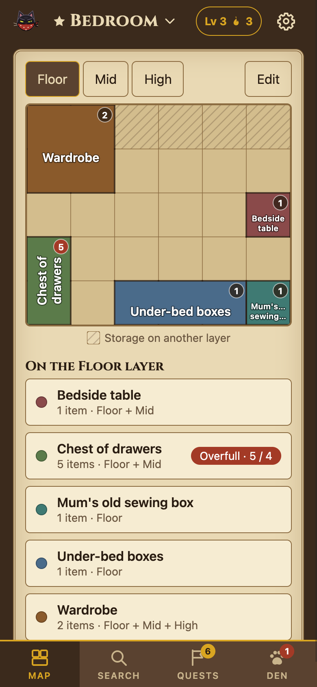
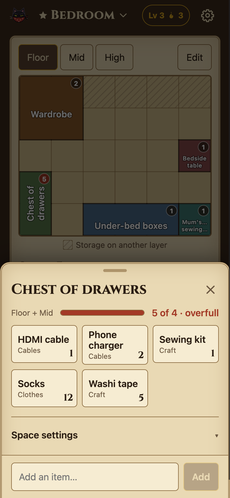
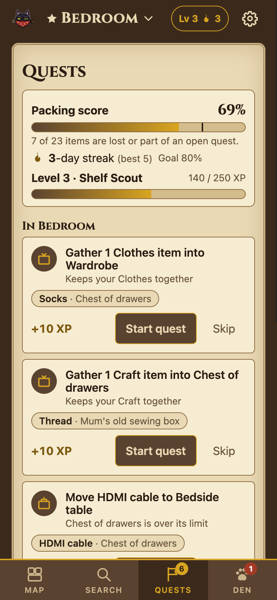
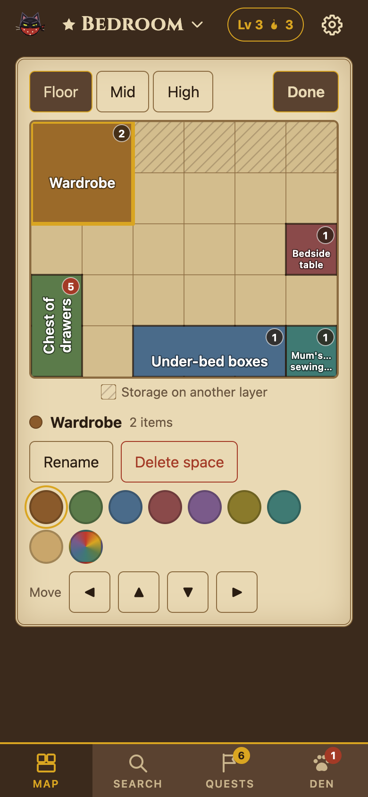
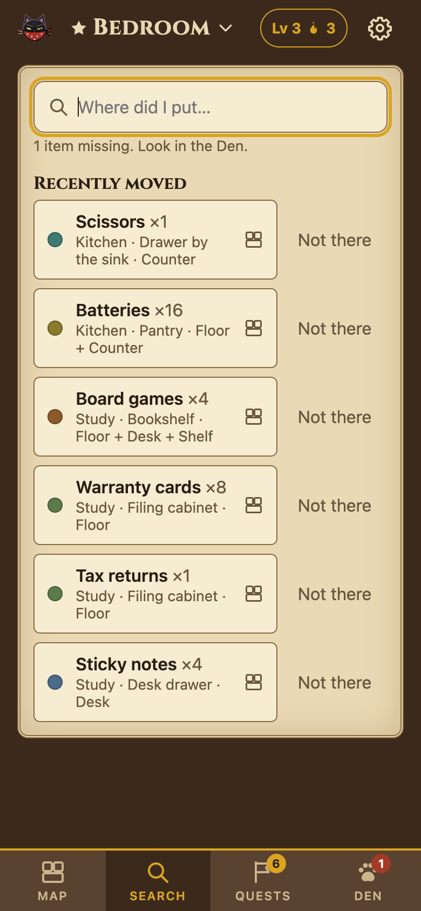
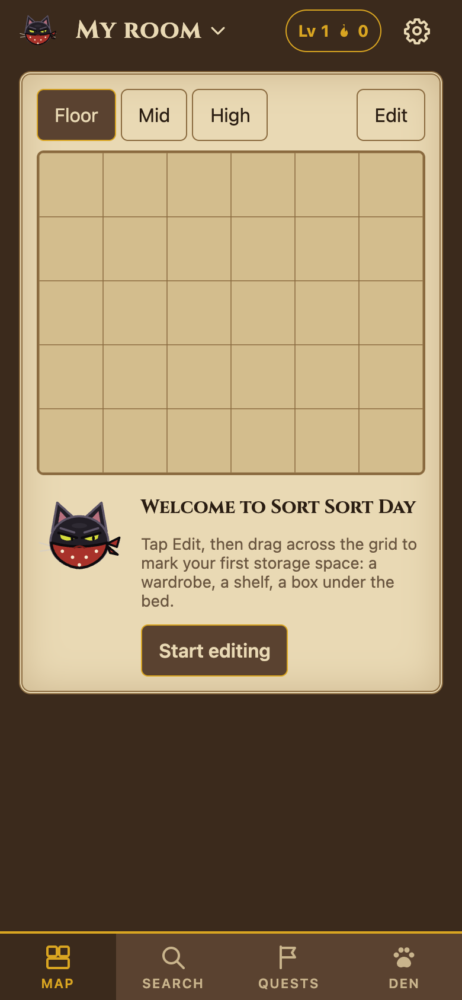

# Sort Sort Day

Slightly silly sorting system: map each room of the house as a grid of mergeable cells and layers, record which items live in which storage space, search for them, and work through tidy-up quests while Bandit the cat "borrows" things. A React + TypeScript PWA, all data on-device in IndexedDB.

Live at https://yewmeng28.github.io/sort-sort-day/ (deployed by GitHub Actions on every push to `main`).

## Screenshots

<table>
  <tr>
    <td align="center"><br><sub>Map your room as a grid</sub></td>
    <td align="center"><br><sub>See what's in each space</sub></td>
    <td align="center"><br><sub>Tidy up with quests</sub></td>
  </tr>
  <tr>
    <td align="center"><br><sub>Draw, merge and move spaces</sub></td>
    <td align="center"><br><sub>Find anything, in any room</sub></td>
    <td align="center"><br><sub>Bandit welcomes you in</sub></td>
  </tr>
</table>

Screenshots use made-up sample data.

## What it does

- **Map each room** as a grid with layers (floor, mid, high). Drag across cells to make a storage space, merge cells into wardrobes and shelves, or span a cupboard through every layer.
- **Record what's where.** Tap a space to see and add its items, with quantity, category and how often you use them.
- **Find anything** across all rooms with search, which jumps to the right space on the map.
- **Tidy with quests.** Suggestions gather scattered categories, empty overfull spaces and bring often-used things within reach, within a room or between rooms. A packing score, daily streak and XP levels track progress.
- **Bandit took it.** Mark an item missing and it waits in the Den until you find it.
- **Private and offline.** Everything stays on your device; export a backup from Settings.

## Develop

```bash
npm install
npm run dev      # http://localhost:5173
npm test         # domain logic: grid, rooms, search, quests, progress, backup validation
npm run build
npm run icons    # render public/icon.svg to the PNG icons (or: npm run icons -- other.svg)
```

## Layout

- `src/domain/`: pure logic and types, unit-tested
  - `grid.ts` merge/unmerge, outlines, labels; `rooms.ts` room editing, moving spaces, moving items
  - `suggestions.ts` quests within and between rooms; `progress.ts` packing score, streak, XP and levels
  - `search.ts`, `categories.ts`, `backup.ts` (validates imports)
- `src/data/`: repository interfaces and the Dexie (IndexedDB) implementation; swap `RepoProvider`'s `repositories` to change storage
- `src/features/`: map editor, rooms and room editor, space and item sheets, search, quests and progress, the Den (missing items), settings (categories, backup, sound, streak goal)
- `src/ui/`: shared components: sheet, toast with Undo, stepper, segmented choice, swatches, icons
- `src/app/`: synthesized UI sounds and the mascot
- `public/`: app icon (`icon.svg` plus generated PNGs) and `mascot.svg`

## Install on iPhone

Open the live URL in Safari, Share → Add to Home Screen. Installed PWAs keep their data longest, and Settings → Export backup is your safety net (keep exports in the gitignored `backups/` folder). iOS caches the home-screen icon at install, so re-add the app after an icon change.
